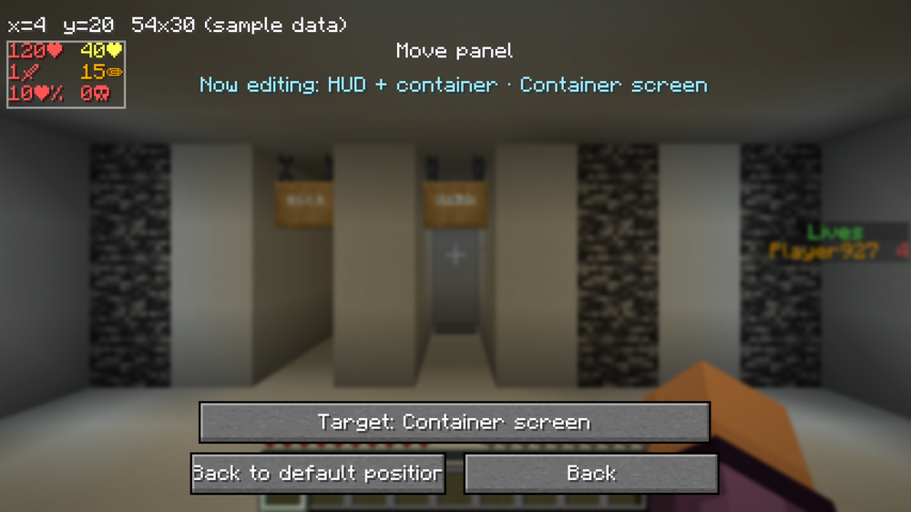

# Cake Team Towers HUD - Fork（蛋糕塔 HUD - 分支版）

[](LICENSE)
[](https://www.minecraft.net/)
[](https://fabricmc.net/)
[](https://adoptium.net/)

> **为地图“蛋糕塔”（Cake Team Towers）制作！**
>
> - 能在敌人、玩家的头顶显示血量条及相关信息
> - 盾牌进入冷却时，会显示冷却指示器
> - 能够随时查看属性的属性面板
>
> **客户端必装、服务端选装**，
> 服务端只装 Fabric API 也能用完整功能。
>
> 当前正式版 **1.6.16**（2026-11-28）；历史版本与下载见 [RELEASES.md](RELEASES.md)。

## 功能

- **头顶血条**：`心数 → 血条 → 名字` 三段一体，血条按当前心类换原版配色纹理（红/黄/紫/蓝/绿）；
  敌人与队友各自独立开关、长度、缩放、最远显示距离与**不透明度**（血条 / 文字分开）。
- **玩家只显示各类心型**：队友与自己都是「魂 / 黑 / 蓝」+「红 当前/上限 + 碎 / 粉」两排心 + 绿条；
  碎心 / 粉心使用地图资源包里的裂心字形（`U+E026`），没装资源包时自动退回 ❤。
  自己的血条有独立开关（默认关），旁观者一律不画。
- **自身属性面板**：定时 `/trigger ViewStats` 抓地图回的属性行，画成 1~3 列面板；
  96 项属性逐项开关（属性 64 / 状态效果 28 / 其它 4，三节分组 + 滚动过滤），可拖动定位、调不透明度与文字阴影；
  支持「HUD / 容器界面 / 两者」三种显示方式，进存档先静默 3 s 避免刷屏。
- **盾牌指示器**：副手盾牌耐久计量条（34×86 纹理，按耐久四档），可调缩放比例与不透明度、可拖动定位。
- **双端精确数据**：服务端也装本 Mod 时，按 UUID 推送每只怪 / 每名玩家（含自己）的权威血量；
  单包最多 **64 条**（玩家优先、其余按距离），协议 v4；服务端没装 / 版本旧时自动回落到客户端渠道。
- **纯客户端可用**：所有基础数据来自客户端可见渠道（Boss 栏、计分板展示槽、实体统计）。
- **不刷屏**：自己触发的 `ViewStats` 输出与 `/trigger` 回显都被吞掉；手动触发照常显示。
- **调试功能页**：优先使用服务端数据、筛选实体数量（1–64）、三个「隐藏」开关（Boss 栏 / 名字下方分数）。
  入口需要**权限 2 级 + `CTT-HUD-LITE-DEBUG` 标签**（标签由装了本 Mod 的服务端下发），不满足时直接灰掉。
- **1.6.x 新增**：常显敌人名称（默认开）；血条不可透视（透明建材 / 植物 / 流体不挡，冰 / 铜格栅 / 有厚度的一律挡住）；
  血量条长度随血量自动调整（上限 75）；`/title` 标题与副标题可整体位移、可分别调不透明度。
- **字体渲染优化**（已独立）：粗体膨胀与告示牌荧光描边优化移至独立 mod [Font Tweaks](https://github.com/nyaLium/Font-Tweaks)；本 mod 不再包含，二者可同时安装。

## 下载

jar 只在 **GitHub Releases** 里：<https://github.com/nyaLium/Cake-Team_Towers-Hud-Lite/releases>

依赖：Fabric Loader ≥ 0.20.1、Fabric API、Java ≥ 25；Mod Menu 可选（装了就有设置入口）。

## 截图

> 截图来自 **1.20.x 测试版**并已压缩（原图在本地归档里）；布局与观感与 1.5.0 一致，
> 仅部分文案改过（「移动面板」→「调整位置…」、「内容过滤」→「显示内容过滤…」、「实体血条设置」→「血条设置」）。

| 属性面板 | 调整位置 | 盾牌指示器 |
| --- | --- | --- |
|  |  |  |

## 安装

1. 客户端：Fabric Loader ≥ 0.20.1 + Fabric API + 本 jar，丢进 `.minecraft/mods`；
2. 服务端（可选）：同一个 jar 放进 `mods` 即可启用按 UUID 的权威血量推送；不装也完全可用；
3. 建议客户端与服务端使用**同一版本**（协议过旧的客户端会整包忽略推送，退回「Boss 栏 + 百分比」）；
4. 游戏内 `F8` 打开设置（Mod Menu 里也有入口）；
5. 配置：`config/ctt-hud-fork.json`（1.20.6 起；旧的 `ctt-enemy-hud.json` 会自动复制过来）。

## 从源码构建

```bash
cd mod
./gradlew build        # 需要 JDK 25；会自动跑 selfCheck（4972 条断言）
# 产物：mod/build/libs/ctt-hud-fork-1.5.0.jar（本地构建用；正式包见 Releases）
```

## 目录结构

| 路径 | 内容 |
| --- | --- |
| `mod/` | 源码工程（Gradle + Loom，Minecraft 26.3 / Fabric） |
| `RELEASES.md` | 正式版清单（版本 / 大小 / SHA-256 / Release 链接） |
| `tools/archive_audit.py` | 归档审计：维护者本地校验 jar 与生成清单（`versions/` 不入库） |
| `LICENSE` / `NOTICE.md` | MIT 许可（含上游 Fork 声明）/ 来源与第三方说明 |

## 发布规则

- **仓库里不放 jar**：正式版的 jar / sources / RELEASE 都作为 **GitHub Release 附件**发布；
- 每个版本都要有归档，**不覆盖、不删除**（维护者本地 `versions/vX.Y.Z/`，已 `.gitignore` 排除）；
- 测试版（1.10.0 – 1.20.42）与 1.3.x–1.4.x 的本地迭代版只在本地归档，不单独发布；
- 维护者发版后运行 `python tools/archive_audit.py` 校验并刷新 `RELEASES.md`。

## 主要文档

- 功能与配置详解：[`mod/README.md`](mod/README.md)（代码导览、配置字段表、界面文案 ↔ 字段对照）
- 版本沿革：[`CHANGELOG.md`](CHANGELOG.md)
- 版本规则：[`VERSIONING.md`](VERSIONING.md)
- 测试清单：[docs/TEST-PLAN.md](docs/TEST-PLAN.md)（环境矩阵 + 分项勾选表）

## 许可

MIT（见 [`LICENSE`](LICENSE)）。本仓库是 Cake-Hud 的 Fork，原版权声明保留；
不打包任何地图 / 资源包 / 原版纹理，来源说明见 [`NOTICE.md`](NOTICE.md)。
