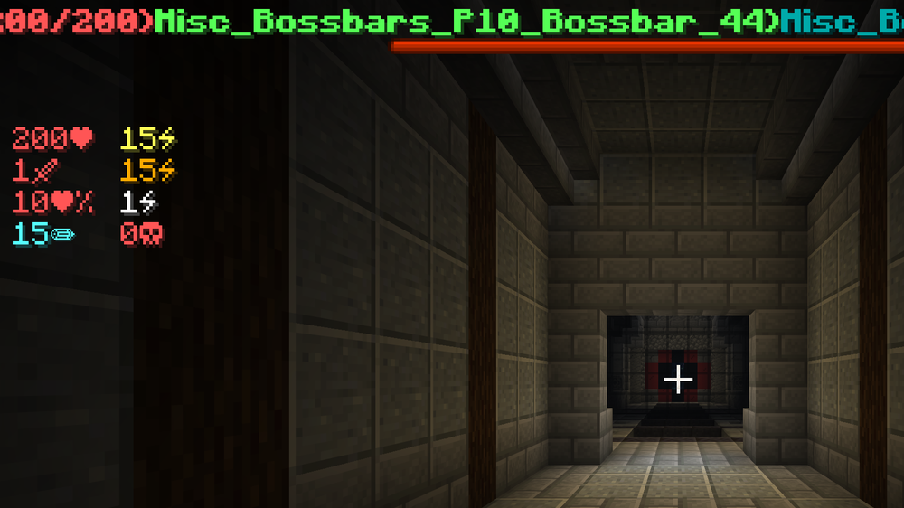
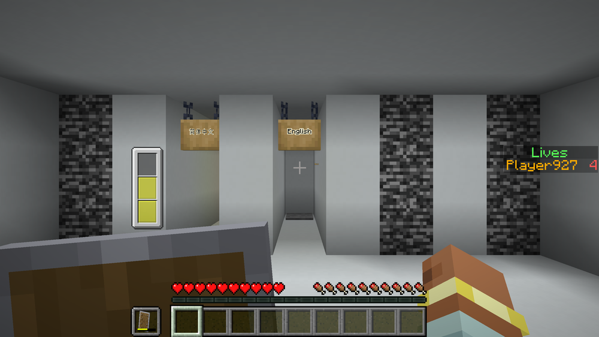

# CTT HUD - Fork

[](LICENSE)
[](https://www.minecraft.net/)
[](https://fabricmc.net/)
[](https://adoptium.net/)

> Cake Team Towers 的客户端 HUD（Fork 自 [Cake-Hud](https://github.com/TheHolyLord/Cake-Hud)，MIT）：
> 敌人 / 队友头顶血条（原版 bossbar 纹理）、队友心数、以及纯客户端的**自身属性面板**
> （`/trigger ViewStats`，88 个属性逐项开关，分「属性 / 状态效果 / 其它」三节）。
>
> **客户端必装、服务端选装**：服务端只装 Fabric API 也能用完整功能。
>
> 当前正式版 **1.0.2**。发布前的 67 个测试版（1.10.0 – 1.20.42）只在本地归档，**不随仓库上传**。

## 功能

- **头顶血条**：`心数 → 血条 → 名字` 三段一体，血条按当前心类换原版配色纹理（红/黄/紫/蓝/绿）；
  敌人与队友各自独立开关、长度、缩放、最远显示距离。
- **自身属性面板**：定时 `/trigger ViewStats` 抓地图回的属性行，画成 1~3 列面板；
  88 个属性逐项开关（三节分组 + 滚动过滤），可拖动定位、调透明度与文字阴影；
  支持「HUD / 容器界面 / 两者」三种显示方式，进存档先静默 3 s 避免刷屏。
- **盾牌指示器**：副手盾牌耐久计量条（34×86 纹理，按耐久四档），可调缩放比例与透明度、可拖动定位。
- **纯客户端**：所有基础数据来自客户端可见渠道（Boss 栏、计分板展示槽、实体），
  服务端装了本 Mod 才额外提供按 UUID 的权威血量（不装自动回落）。
- **不刷屏**：自己触发的 `ViewStats` 输出与 `/trigger` 回显都被吞掉；手动触发照常显示。

## 下载

| 版本 | 文件 | 说明 |
| --- | --- | --- |
| **1.0.2**（正式版 · 唯一可用） | [`versions/v1.0.2/ctt-hud-fork-1.0.2.jar`](versions/v1.0.2/ctt-hud-fork-1.0.2.jar) | 客户端必装；同一个 jar 放服务端即启用权威数据推送（选装） |

> **1.0.0 / 1.0.1 已撤回**：这两个版本的 `LICENSE` 把上游版权人写成了仓库账号名（实际为 `Copyright (c) 2026 Kirin0321 (麒麟)`）。为免分发署名错误的产物，它们的 jar、归档与 tag 已从本仓库移除，**请只使用 1.0.2**。

依赖：Fabric Loader ≥ 0.20.1、Fabric API、Java ≥ 25；Mod Menu 可选（装了就有设置入口）。
配置：`config/ctt-hud-fork.json`；旧的 `ctt-enemy-hud.json` 会自动复制迁移。

## 截图

> 截图来自 **1.20.x 测试版**并已压缩（原图在本地归档里）。1.0.0 改过部分文案
> （「移动面板」→「调整位置…」、「内容过滤」→「显示内容过滤…」、「实体血条设置」→「血条设置」），
> 布局与观感一致，按钮名字以外没有差别。

| 属性面板 | 调整位置 | 盾牌指示器 |
| --- | --- | --- |
|  |  |  |

## 安装

1. 客户端：Fabric Loader ≥ 0.20.1 + Fabric API + 本 jar，丢进 `.minecraft/mods`；
2. 服务端（可选）：同一个 jar 放进 `mods` 即可启用按 UUID 的权威血量推送；不装也完全可用；
3. 游戏内 `F8` 打开设置（Mod Menu 里也有入口）；
4. 配置：`config/ctt-hud-fork.json`（1.20.6 起；旧的 `ctt-enemy-hud.json` 会自动复制过来）。

## 从源码构建

```bash
cd mod
./gradlew build        # 需要 JDK 25；会自动跑 selfCheck（4786 条断言）
# 产物：mod/build/libs/ctt-hud-fork-1.0.2.jar
```

## 目录结构

| 路径 | 内容 |
| --- | --- |
| `mod/` | 源码工程（Gradle + Loom，Minecraft 26.3 / Fabric） |
| `versions/vX.Y.Z/` | **正式版的归档**（当前只有 v1.0.2）：jar、sources、README、RELEASE；发布前的测试版（1.10.0 – 1.20.42）**只在本地**，已被 `.gitignore` 排除 |
| `versions/ARCHIVE.md` | 全部版本的清单（大小 / SHA-256 / 内嵌版本号 / git 标签） |
| `versions/VERSIONING.md` | 版本保留规则（每版必留档，不覆盖、不删除）与上传流程 |
| `versions/tools/archive_audit.py` | 归档审计：重新生成 `ARCHIVE.md` 并校验 |
| `ctt-hud-fork-1.0.2.jar` | 最新版 jar（与 `versions/v1.0.2/` 中的字节一致） |
| `LICENSE` / `NOTICE.md` | MIT 许可（含上游 Fork 声明）/ 来源与第三方说明 |

## 归档规则

- 每个版本都必须有归档目录，**不覆盖、不删除**：**正式版**在 `versions/v1.0.x/` 并随仓库上传；**发布前的测试版**在本地 `versions/pre-release/vX.Y.Z/`（不进仓库）；
- 归档内容：jar + sources + README + RELEASE（+ 实机截图）；
- 每次发版后运行 `python versions/tools/archive_audit.py`，刷新 `versions/ARCHIVE.md`；
- 根目录只保留**最新一版**的 jar，历史 jar 全部在 `versions/` 里。

## 主要文档

- 功能与配置详解：[`mod/README.md`](mod/README.md)（代码导览、配置字段表、界面文案 ↔ 字段对照）
- 版本沿革：[`CHANGELOG.md`](CHANGELOG.md)
- 最新版说明：[`versions/v1.0.1/RELEASE.md`](versions/v1.0.1/RELEASE.md)
- 归档清单：[`versions/ARCHIVE.md`](versions/ARCHIVE.md)

## 许可

MIT（见 [`LICENSE`](LICENSE)）。本仓库是 Cake-Hud 的 Fork，原版权声明保留；
不打包任何地图 / 资源包 / 原版纹理，来源说明见 [`NOTICE.md`](NOTICE.md)。
